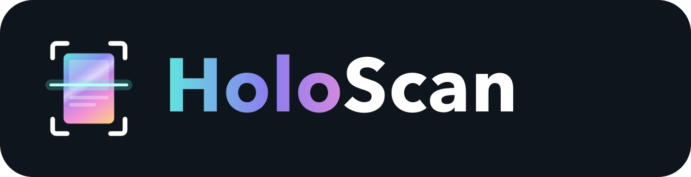

# HoloScan

Identify Pokémon TCG cards with the phone camera, fully on-device, and keep a
collection with estimated prices. No account, no server, no ads.

**Download:** the Android APK is on the [Releases](../../releases) page.
Copy it to the phone and open it, allowing "install unknown apps".

## Features

- **On-device recognition** of 26,675 English cards: main sets, promos, McDonald's,
  Prize Pack and deck exclusives, World Championship decks and more. The camera
  image never leaves the phone.
- **Steady result:** once a card is recognised it stays on screen until the card
  leaves the frame. Other candidates keep a fixed order.
- **One-handed:** ✓ adds the card, ✕ opens a list to pick the right printing.
  Buttons can be on the left or right.
- **Auto-add** after holding a card for 1–5 s (configurable, or off). Only confident
  matches (≥ 60%) are added automatically.
- **Prices:** a TCGplayer (USD) / Cardmarket (EUR) snapshot is built into the app.
  *Refresh prices* updates the cards in your collection, at most 5 times an hour.
- **Backup:** export the collection as a zip of CSV files, then import it on another
  phone or open it in a spreadsheet.
- Two models: **Fast (int8)**, the default, and **Full (fp32)**, same accuracy in testing.

> **Disclaimer:** card identification is done by an AI model and can be wrong,
> especially between reprints that share the same artwork. Prices are estimates
> from public market data and may be outdated or inaccurate. Always double-check
> the card and its value before buying, selling or trading. HoloScan is provided
> as is, without warranty, and the authors are not responsible for any loss from
> relying on its results (see "No Liability" in the [license](LICENSE.md)).

Cards are recognised right side up only. Same-art reprints look identical to
the camera, so check the set and number and pick the exact one with ✕ if needed.

## Repository

- `android/`: the Android app (Kotlin, Compose, CameraX, ONNX Runtime). See `android/README.md`.
- `ml/`: the Python pipeline (uv). Card data and images, embedding index, fine-tuning,
  phone exports and the price snapshot.
- `docs/TRAINING.md`: data collection, training method, hyperparameters, full vs int8 models.
- `docs/logo/`: logo and app icon sources.
- `scripts/fetch_models.sh`: downloads model weights from the release (too large for git).

What's versioned and what's a release asset:

| File | Where |
|---|---|
| Card index (26,675 × 384 float16), card list, price snapshot | `android/app/src/main/assets/` (git) |
| Card ids, reprint groups, preprocessing contract | `embeddings/` (git) |
| `embedder.int8.onnx` (22 MB), `embedder.onnx` (87 MB) | release, via `scripts/fetch_models.sh` |
| `backbone.pt` (PyTorch checkpoint), `embeddings.f32.npy`, `Embedder.mlpackage` (Core ML) | release, via `scripts/fetch_models.sh --all` |
| Card images | not distributed; `ml/download_images.py` fetches them |

## Build the app

```sh
scripts/fetch_models.sh
cd android
./gradlew :app:testDebugUnitTest :app:assembleDebug
adb install -r app/build/outputs/apk/debug/app-debug.apk
```

## Rebuild the model and index

```sh
cd ml
uv run python download_images.py   # card images -> HOLOSCAN_NAS (default ~/nas/arthur/pokemon-tcg)
uv run python build_cache.py       # local 336x462 working copies (cache/train)
uv run python embed.py             # pretrained index -> embeddings/dinov2-s14-224x308
uv run python art_groups.py        # same-artwork reprint groups -> embeddings/art_groups.json
uv run python finetune.py          # -> embeddings/dinov2-s14-224x308-ft/backbone.pt
T=dinov2-s14-224x308-ft; C=../embeddings/$T/backbone.pt
uv run python embed.py --checkpoint $C --tag $T
uv run python extra_sets.py --tier 1   # extra cards from TCGplayer listings (tiers 1-3)
uv run python embed.py --checkpoint $C --tag $T --append
uv run python eval_synthetic.py --tag $T --checkpoint $C [--loose]
uv run python export.py --tag $T --checkpoint $C
uv run python export_android.py --tag $T
uv run python fetch_prices.py      # price snapshot -> android assets/prices.json (~20k requests, cached)
```

Paths are in `ml/config.py`. Details and results are in `docs/TRAINING.md`.

## Prices

The bundled snapshot is built with `ml/fetch_prices.py` from
[TCGdex](https://tcgdex.dev) (TCGplayer USD, Cardmarket EUR) and
[TCGCSV](https://tcgcsv.com) (TCGplayer prices for cards TCGdex doesn't cover).
The app reads prices through `PriceSource` (`android/.../Prices.kt`), so the
source can be swapped later without touching the UI. Prices are estimates, not offers.

## Contributing

Contributions are welcome, especially:

- **An iPhone app.** The Core ML model (`Embedder.mlpackage`, in the release) and the
  shared card index are ready; it needs the camera, lock and collection logic ported.
- **Models for other trading card games.** The pipeline in `ml/` is game-agnostic:
  card images and metadata in, an embedding index out. Add a data source and a
  config, and the same training and export steps apply.
- Fixes, missing cards, better price sources, translations.

See [CONTRIBUTING.md](CONTRIBUTING.md). Please open an issue first for anything large.

## License

[PolyForm Noncommercial 1.0.0](LICENSE.md): free to use, change and share for
any noncommercial purpose. Commercial use is not allowed. Third-party credits
are in [NOTICE.md](NOTICE.md).

HoloScan is an unofficial fan project. It is not affiliated with, endorsed or
sponsored by Nintendo, Creatures Inc., GAME FREAK inc. or The Pokémon Company.
Pokémon and card names are trademarks of their respective owners.
